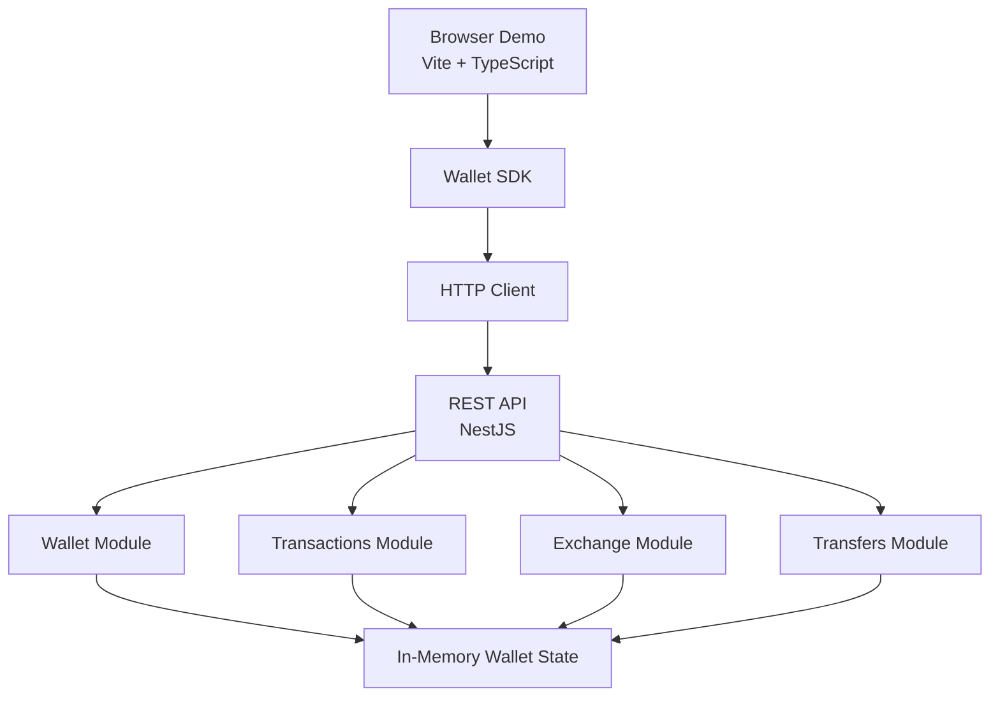

# System Architecture

## 1. Overview

Wallet SDK Lab is a TypeScript-based monorepo demonstrating a modular digital wallet system.

The project consists of three main layers:

- **API:** Handles wallet operations and business logic.
- **SDK:** Provides a reusable client for communicating with the API.
- **Demo:** Provides a browser-based interface that uses the SDK.

The architecture separates application responsibilities to make the system easier to understand, maintain, test, and extend.

## 2. High-Level Architecture



## 3. Main Components

### 3.1 Wallet API

**Location:** `apps/api/`

The backend is built with NestJS and exposes REST endpoints under:

```text
/api/v1
```

Responsibilities:

- Handle incoming HTTP requests.
- Validate request payloads.
- Execute wallet operations.
- Manage balances and transactions.
- Return structured API responses.
- Handle application errors.

The API uses NestJS modules to separate business responsibilities.

Main modules include:

| Module | Responsibility |
|---|---|
| Wallet | Wallet information and balances |
| Transactions | Transaction history |
| Exchange | Currency conversion |
| Transfers | Demonstration transfers |
| Common | Shared application functionality |

### 3.2 Wallet SDK

**Location:** `packages/sdk/`

The SDK is a reusable TypeScript client that abstracts direct HTTP communication.

Main components:

| Component | Responsibility |
|---|---|
| `client.ts` | Main SDK interface |
| `http-client.ts` | HTTP communication |
| `services/` | API service classes |
| `types/` | TypeScript interfaces and types |
| `errors/` | SDK error handling |
| `index.ts` | Public package exports |

The SDK exposes the following methods:

```typescript
getWallet()
getBalance()
getTransactions()
exchange(data)
transfer(data)
```

The SDK handles HTTP communication and provides typed responses to its consumers.

### 3.3 Browser Demo

**Location:** `apps/demo/`

The Demo is a browser-based dashboard built with:

- Vite
- TypeScript
- Tailwind CSS v4

It demonstrates how a frontend application can consume the SDK.

Main functionality:

- Display wallet information.
- Display USD and EUR balances.
- Exchange currencies.
- Perform demonstration transfers.
- Display transaction history.
- Handle API errors.

## 4. Request Lifecycle

A typical request follows this sequence:

1. The user performs an action in the Demo.
2. The Demo calls the corresponding SDK method.
3. The SDK delegates the operation to its service.
4. The HTTP client sends a request to the API.
5. NestJS validates and processes the request.
6. The API returns a response.
7. The SDK resolves the response or throws an SDK error.
8. The Demo updates the interface.

## 5. Workspace Organization

The repository uses npm Workspaces.

Main workspaces:

```json
{
  "workspaces": [
    "apps/api",
    "apps/demo",
    "packages/sdk"
  ]
}
```

This allows the API, Demo, and SDK to share one repository while maintaining separate package configurations.

## 6. Data Management

The current implementation uses in-memory wallet data.

This means:

- Wallet data is initialized when the API starts.
- Balances are updated during operations.
- Transactions are stored during runtime.
- Restarting the API resets the wallet state.

No persistent database is currently configured.

## 7. Currency Handling

The API represents monetary values using integer minor units.

Examples:

| Currency | Minor Units | Display Value |
|---|---:|---:|
| USD | 250000 | $2,500.00 |
| EUR | 100000 | €1,000.00 |

This approach avoids common floating-point precision issues when handling monetary amounts.

## 8. Design Principles

The project follows these principles:

- Separation of concerns.
- Modular backend organization.
- Reusable SDK architecture.
- Type-safe communication.
- Centralized HTTP handling.
- Request validation.
- Explicit error handling.

## 9. Current Architecture Limitations

The current implementation is a demonstration system.

It does not include:

- Persistent database storage.
- Authentication and authorization.
- Multi-user wallet isolation.
- Production-grade transaction concurrency controls.
- Real payment processing.
- Production deployment infrastructure.

These capabilities would need to be implemented before considering production use.